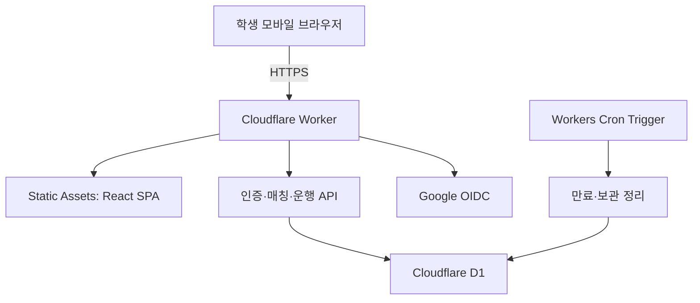
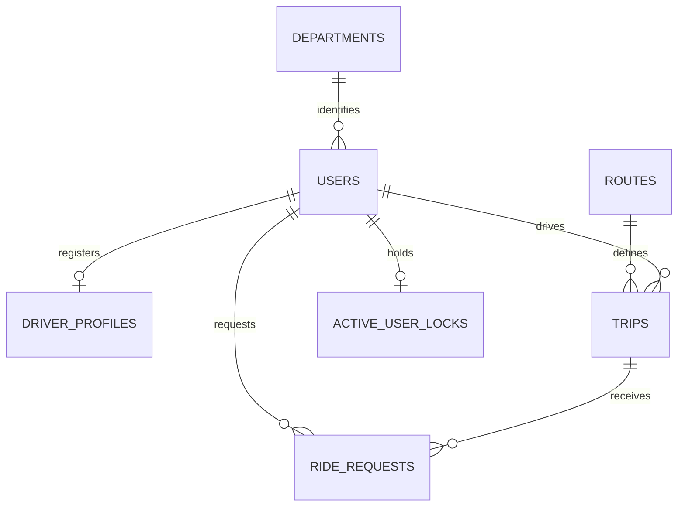

# 교내 동승 매칭 웹앱 — Architecture

문서 버전: 0.9 · 기준일: 2026-10-31 · 상태: 2026-10-31 사용자 결정으로 실시간 위치 공유를 중단하고 등록 승차 지점을 선택해 기다리는 흐름으로 변경했다. 브라우저 Geolocation을 호출하지 않고 Worker 위치 라우트와 지도 SDK 런타임을 제거했으며 지도 SDK CSP 허용도 없다. 위치정보법 분류·신고와 고정 지점 선택의 법적 취급은 미확정이며 법률 준수·면제 판단이 아니다. 구형 위치 테이블·migration 및 local/staging/복구 사본의 정리 여부는 미완료다. 학교 공식 승인·책임자 지정, 국외처리 상세, 외부 권한대장·복구 훈련도 미완료다. staging은 OIDC 계정 검증 전용(사용자·세션 생성 없음)이며 일반 API는 차단한다.

제품 범위는 [Project.md](Project.md), 작업 순서는 [Roadmap.md](Roadmap.md), 에이전트 지침은 [AGENTS.md](AGENTS.md)를 따른다. 현재 만남 흐름은 운영자가 등록한 노선의 출발 지점을 선택해 현장에서 대기하고 탑승 코드로 확인하는 방식이다. legacy 위치 테이블·migration과 데이터 보존·삭제 검토는 남아 있지만 위치 API 및 지도 런타임은 제거했다. 현재 런타임 동작은 §8, 과거 구현 기록은 §21~22를 참고한다.

## 1. 시스템 구성



| 구성 | 선택 | 역할 |
| --- | --- | --- |
| 웹 | React + Vite + TypeScript | 모바일 UI, 등록된 승차 지점·운행 선택 |
| API | Hono + Zod + TypeScript | 인증·인가·입력 검증·매칭·상태 전이 |
| 호스팅 | Workers Static Assets | 정적 프런트와 API를 같은 origin에서 제공 |
| DB | D1 | 사용자·세션·운행·요청·운영 기록. legacy 위치 테이블은 사용 중지 상태 |
| 정리 | Worker `scheduled()` | 만료 처리, 위치·세션·멱등 기록 삭제 |
| 인증 | Google OIDC | 학교 조직 계정 확인, 서비스 세션 발급 |
| 위치 | 고정 카탈로그 지점 | 이용자는 노선 지점만 선택하며 브라우저 좌표를 수집하지 않음 |
| 테스트 | Vitest + Workers 런타임, Playwright | 도메인·D1·브라우저 검증 |

MVP에는 KV·Durable Objects·Queues·R2·외부 DB가 필요하지 않다. D1이 상태의 기준이며 Worker 인스턴스 메모리에 영속 상태를 두지 않는다.

## 2. 배포와 라우팅

하나의 Worker가 정적 파일과 `/api/*`를 제공한다. 빌드 산출물은 예시로 `dist/web`, Worker 진입점은 `src/worker/index.ts`다. 프런트 주소를 새로고침해도 SPA가 열려야 하며 `/api/*` 오류는 HTML 대신 JSON이어야 한다.

Wrangler 구성 골격은 다음과 같다. 실제 ID·학교 설정·환경은 P0~P1에서 채운다. 빈 ID를 둔 채 운영 배포하지 않는다. 환경별 DB 바인딩·vars는 명시적으로 선언하며 자동 상속을 가정하지 않는다.

```jsonc
{
  "$schema": "node_modules/wrangler/config-schema.json",
  "name": "campus-ride-dev",
  "main": "src/worker/index.ts",
  "compatibility_date": "2026-10-27",
  "assets": {
    "directory": "./dist/web",
    "binding": "ASSETS",
    "not_found_handling": "single-page-application",
    "run_worker_first": ["/api/*"]
  },
  "d1_databases": [{
    "binding": "DB",
    "database_name": "campus-ride-dev",
    "database_id": "REPLACE_WITH_DEV_D1_ID",
    "migrations_dir": "migrations"
  }],
  "triggers": { "crons": ["*/5 * * * *"] },
  "vars": {
    "APP_ENV": "development",
    "APP_ORIGIN": "http://localhost:8787",
    "SCHOOL_CONFIG_READY": "false",
    "ALLOW_DEV_AUTH": "false"
  }
}
```

`compatibility_date`는 실제 개발 시 지원 여부를 확인해 고정한다. 실제 dev 서버 포트도 `APP_ORIGIN`과 맞춘다. staging·production은 별도 Worker·D1·Google OAuth client·Secrets를 사용한다. staging은 `STAGING_AUTH_TEST_ONLY=true`일 때 Google start/callback만 허용한다. callback은 OIDC와 `gachon.ac.kr` 이메일·Workspace `hd`를 검증하되 사용자·학생확인·세션을 만들지 않는다. 모든 다른 `/api/*`는 503이며 `SCHOOL_CONFIG_READY=false`, `ALLOW_DEV_AUTH=false`를 유지한다. 실제 학교 계정 claim과 정책·운영 설정을 확인하기 전에는 normal API를 열지 않는다. 준비 후에도 자격은 학적이 아니라 인증된 계정 보유 여부로 판정한다.

공식 근거: [Static Assets](https://developers.cloudflare.com/workers/static-assets/), [Wrangler assets 설정](https://developers.cloudflare.com/workers/wrangler/configuration/#assets), [Cron Triggers](https://developers.cloudflare.com/workers/configuration/cron-triggers/). `scheduled()` 실행 지연이나 일시 실패가 있어도 요청 시점의 만료 검증은 계속 작동해야 한다.

## 3. 인증·학적·학과

### 3.1 로그인 절차

1. `GET /api/v1/auth/google/start`가 state·nonce·브라우저 연계 쿠키를 만든다. state/nonce 원문을 로그에 남기지 않는다. 만료는 10분이다.
2. Google Authorization Code 흐름으로 `openid email profile`만 요청한다. 학생 명부·디렉터리는 별도 승인된 연동 없이는 접근하지 않는다.
3. callback이 브라우저 연계와 state를 검증하고 한 번만 소비한다. 고정된 redirect URI와 허용된 내부 복귀 경로만 사용한다.
4. 서버가 코드를 교환하고 공식 discovery/JWKS로 ID 토큰 서명을 검증한다. 허용 issuer·audience·exp·nonce·`email_verified=true`를 검사한다. 복수 audience가 가능하면 `azp`도 확인한다.
5. 검증된 `hd`가 허용 조직에 속하고 정규화된 이메일 도메인이 허용 목록과 정확히 일치해야 한다. 요청의 `hd`는 계정 선택 힌트일 뿐 접근 통제가 아니다. 학교가 Workspace를 쓰지 않는다면 이 전제를 재설계하기 전 운영 허용하지 않는다.
6. `google_sub`로 계정을 조회/생성한다. 이메일 변경만으로 타 계정과 자동 병합하지 않는다. 이메일 중복 충돌은 운영 확인 대상으로 처리한다.
7. 자체 세션을 발급한다. 로그인 용도로만 받은 Google 토큰은 검증 후 버리고 refresh token을 요청·보관하지 않는다.

Google 토큰 검증 근거: [OpenID Connect](https://developers.google.com/identity/openid-connect/openid-connect), [ID token 검증](https://developers.google.com/identity/openid-connect/openid-connect#validatinganidtoken).

### 3.2 서비스 세션

- 256비트 이상의 무작위 토큰을 쿠키로 전달하고 D1에는 SHA-256 해시만 보관한다.
- 운영 쿠키: `__Host-campus_session`, `HttpOnly`, `Secure`, `SameSite=Lax`, `Path=/`, Domain 속성 없음.
- 기본 세션은 최대 7일, 유휴 만료는 24시간이다. 유휴 갱신 쓰기는 최대 15분에 한 번으로 제한한다.
- 상태 변경은 정확한 Origin + 세션에 연결된 CSRF 토큰을 검증한다. CSRF 토큰은 별도 `CSRF_HMAC_KEY`로 세션 원문에 HMAC을 적용해 재생성 가능한 값으로 만들고, `/me` 등 인증된 same-origin 경로로 제공한다. 서버는 쿠키와 서버 키로 기대값을 재계산하고 상수 시간 비교를 사용한다. DB에 CSRF 해시만 둔 채 원문을 다시 읽어 올 수 있다고 가정하지 않는다.
- 로그아웃·정지·자격 만료·탈퇴 시 기존 세션을 폐기한다. 자격 만료 학생의 다음 요청에는 학생 확인 재신청이 가능한 제한 세션을 발급한다. 운영자 변경은 감사 기록을 남긴다.
- 인증·사용자별 응답은 `no-store`다. CORS는 기본 same-origin이며 임의 Origin을 허용하지 않는다.

### 3.3 계정 이용 자격과 학과 파싱

사용자 결정에 따라 현재 재학생 여부를 별도로 심사하지 않고 정상 인증된 가천대학교 Google 계정의 소유자를 이용 자격으로 인정한다. Worker는 Google ID token의 서명·issuer·audience·만료·nonce, `email_verified`, `gachon.ac.kr` 이메일, 설정된 Workspace `hd`를 검증한 뒤 `SCHOOL_ASSERTION`을 기록하고 내부 계정을 `VERIFIED`로 표시한다. 이 정책은 해당 Workspace를 가진 교직원·졸업생도 허용한다. 앱 내부의 `STUDENT`와 `VERIFIED` 표시는 기능 접근용 상태이며 재학생·학적 확인 사실이 아니다. 자격 기간은 세션 최대 수명과 같은 7일이며 Google 재인증 시 갱신한다. 실제 학교 이메일·`hd` 규칙은 staging 검증 전까지 normal auth에 반영된 것으로 간주하지 않는다.

실제 학교 계정 이용 시험은 `STAGING_AUTH_TEST_ONLY=true`인 닫힌 staging에서 수행한다. 이 모드는 start/callback 외 모든 API를 503으로 막고, callback은 검증 결과만 일반 문구로 보여준 뒤 OAuth 임시 상태를 삭제한다. 토큰·이메일·`sub`를 응답이나 앱 로그에 남기지 않고 D1에 사용자·확인·세션 행을 만들지 않는다. Workspace 계정 선택과 Google 동의는 사용자가 직접 한다.

학과 파서는 다음 계약을 가진다.

```ts
type DepartmentParseResult = {
  departmentId: string | null;
  source: 'DIRECTORY' | 'EMAIL_LOCAL_PART' | 'GOOGLE_NAME' | 'SELF_REPORTED';
  status: 'VERIFIED' | 'UNVERIFIED' | 'UNKNOWN';
  parserVersion: string;
};
```

학교별 설정으로 `sourceField`, 제한된 구분자 템플릿, 별칭→정규 코드 표를 둔다. 템플릿은 `{id}`, `{*}`, `{department}` 토큰으로 지정하고 값은 `-`, `.`, `_` 중 구분자 하나로 나눈 뒤 위치마다 정확히 비교한다. 사용자에게서 받은 이메일/표시 이름을 설정된 JavaScript 정규식에 대입하지 않아 ReDoS를 막는다. 정확히 하나의 활성 학과 코드와 일치하면 후보를 만들고 여러 개/없음/잘못된 포맷이면 `UNKNOWN`이다. 실제 이메일·이름 예시는 익명화해 파서 fixture로만 사용한다. 학교가 수정 불가능하게 관리하는 필드이거나 승인된 학적 정보로 확인된 경우만 `VERIFIED`로 승격한다. 변경 가능한 Google 이름은 추출 성공만으로 검증되지 않는다.

학교 학과 규칙을 확인하기 전에는 파서 설정을 원격 필수값으로 만들지 않고 `UNKNOWN`/`parserVersion=null`로 둔다. 이를 이유로 Google 계정 이용 자격을 거부하지 않는다. 미확인 학과는 운영 확인이나 학교가 제공하는 정보로 보완한다. 사용자가 학과를 바꾸면 다시 미확인으로 돌아간다. `departmentId`가 있어도 `VERIFIED`가 아니면 같은 학과 우선 대상으로 세지 않는다.

## 4. 도메인 모델과 D1 데이터 사전

### 4.1 공통 규칙

- ID는 서버가 생성하는 UUID TEXT, 시간은 UTC Unix epoch **밀리초 INTEGER**다. 화면만 `Asia/Seoul`로 표시한다.
- 서버가 동일 mutation의 `now_ms`를 한 번 결정한다. 클라이언트 시간이 만료·수락 순서를 결정하지 않는다.
- 외래키·CHECK·UNIQUE·부분 unique index를 migration에서 선언한다. D1에서 실제 지원·실행을 검증한다.
- 학교/캠퍼스는 첫 버전 단일 값이어도 사용자·지점·노선에 일관되게 연결해 교차 매칭을 막는다.
- `users.gender`와 운행/요청의 성별 스냅샷은 API 공개용 프로필과 분리한다.
- 탈퇴는 계정 접근을 닫고 직접 식별 정보를 대체값으로 바꾸지만 이력을 모두 CASCADE 삭제하지 않는다. 신고·운행·동의·감사 기록은 보관 근거와 기간이 정해질 때까지 남을 수 있으며, D1 복구 사본도 즉시 삭제된다고 보장하지 않는다. 계정 삭제 때 차단 관계와 탈퇴 사용자의 위치 제공 내역에 남은 닉네임 스냅샷은 정리한다.

### 4.2 테이블

| 테이블 | 핵심 컬럼 | 제약·용도 |
| --- | --- | --- |
| `users` | id, google_sub, school_id, campus_id, email, nickname, department_id, department_status, department_source, parser_version, gender, affiliation_status, verified_until, account_status, role, created_at, updated_at | sub UNIQUE, 정규화 email UNIQUE, role=`STUDENT/ADMIN`, account_status=`ACTIVE/SUSPENDED/DELETED` |
| `student_verifications` | id, user_id, method, outcome, department_id, reviewed_by, verified_at, valid_until, reference_digest | 학생/학과 확인 근거 메타데이터. 신분증 원본 저장 안 함 |
| `departments` | id, school_id, code, name, aliases_json, active | UNIQUE(school_id, code), 학과 별칭 사전 |
| `stops` | id, school_id, campus_id, name, kind, lat, lng, active | kind=`GATE/DESTINATION`, 실제 안전 지점만 활성 |
| `routes` | id, school_id, campus_id, origin_stop_id, destination_stop_id, active | 양 지점의 학교·캠퍼스를 복합 FK로 일치시킨 허용 편도 노선. 임의 좌표로 운행 생성 금지 |
| `driver_profiles` | user_id, vehicle_model, vehicle_color, vehicle_identifier, passenger_capacity, verification_status, verified_until, checked_at | user_id PK/FK, 운전자 확인·차량 식별. 일반 목록에는 식별자 비공개 |
| `trips` | id, driver_id, route_id, departure_at, expires_at, seat_capacity, gender_snapshot, gender_filter, department_id_snapshot, department_verified_snapshot, prefer_same_department, status, version, last_command_id, started_at, ended_at, created_at | seat_capacity 1~4 및 차량 정원 이하. 스냅샷·조건은 활동 중 고정 |
| `ride_requests` | id, trip_id, rider_id, desired_departure_at, gender_snapshot, gender_filter, department_id_snapshot, department_verified_snapshot, prefer_same_department, status, expires_at, accepted_at, boarded_at, boarding_code_hash, boarding_code_expires_at, boarding_attempt_count, version, last_command_id, created_at | 상태별 타임스탬프, 짧은 수명 탑승 코드 해시 |
| `active_user_locks` | user_id, role, trip_id, request_id, created_at | user_id PK, DRIVER는 trip_id만, RIDER는 request_id만. 한 사람의 동시 활동 방지 |
| `latest_locations` | user_id, trip_id, request_id, lat, lng, accuracy_m, captured_at, received_at, expires_at, sequence | legacy 위치 공유 데이터. 새 런타임 경로는 쓰지 않음. 기존 행/복구 사본은 별도 검토 |
| `location_disclosure_records` | id, owner_user_id, recipient_user_id, recipient_nickname, recipient_role, trip_id, request_id, sequence, purpose, requested_at, notice_acknowledged_at, position_delivered_at, post_notice_acknowledged_at | legacy 확인 자료 테이블. 새 런타임 경로는 쓰지 않음. 과거 자료 보유·삭제 근거 미확정 |
| `location_notice_presence` | user_id, trip_id, request_id, last_seen_at, expires_at | legacy 위치 공유 presence 테이블 |
| `location_access_records` | id, user_id, location_owner_user_id, action, trip_id, request_id, accessed_at | legacy 위치 접근기록 테이블. 좌표 미포함 |
| `sessions` | token_hash, user_id, csrf_hash, created_at, last_seen_at, expires_at, revoked_at | 원문 세션 토큰 금지. token_hash PK |
| `oauth_states` | state_hash, nonce_hash, browser_binding_hash, safe_return_path, created_at, expires_at, consumed_at | state 1회 사용 및 브라우저 연계. PKCE 채택 시 verifier도 짧게 보호·보관 |
| `consents` | id, user_id, kind, policy_version, granted_at, revoked_at | 약관·개인정보 안내와 legacy 위치 동의 기록. 위치 동의는 현재 권한 조건이 아님 |
| `user_blocks` | blocker_id, blocked_id, created_at, last_event_id | 복합 PK, 자기 차단 금지, 양방향 후보 제외. 신규 생성·해제는 감사 이벤트로만 가능 |
| `reports` | id, reporter_id, reported_user_id, trip_id, request_id, category, description, status, assigned_to, created_at, resolved_at | 당사자가 관련 운행을 신고. 본문 길이 제한, 운영자만 처리 |
| `audit_events` | id, actor_id, event_type, resource_type, resource_id, command_id, safe_metadata_json, created_at | 상태 변경·승인·제한·접근 처리. 좌표·이메일·코드·토큰 금지 |
| `idempotency_keys` | user_id, operation, key, request_hash, command_id, result_json, http_status, created_at, expires_at | 복합 PK, command_id UNIQUE. 제한 정보 없는 mutation 결과만 저장 |
| `rate_limit_buckets` | subject_hash, operation, window_start, count, expires_at | 복합 PK(subject_hash, operation, window_start). 플랫폼 제한 기능을 쓰지 않을 때의 원자적 카운터. IP는 단기 HMAC 값만 사용 |

위 네 위치 테이블은 이전 실시간 위치 구현의 잔여 schema다. 현재 제품은 단말 좌표를 수집·저장·제공하지 않으며 location API도 등록하지 않는다. 고정 노선 지점 선택은 운행/요청 ID와 연결되므로 의도한 만남 장소를 나타낼 수 있다. 이 정보의 위치정보법·개인정보보호법상 성격, 사업자 분류·신고, 처리 근거는 실제 운영 범위를 정해 검토해야 하며 이번 코드 변경이 면제나 준수를 뜻하지 않는다. 기존 D1 행과 Time Travel 복구 사본의 보유·삭제 계획은 미완료다.

### 4.3 관계와 인덱스



다음은 초기 필수 인덱스다.

| 대상 테이블 | 컬럼/조건 |
| --- | --- |
| `trips` | `(route_id, status, departure_at, id)`, `(driver_id, created_at)` |
| `ride_requests` | `(trip_id, status, created_at, id)`, `(rider_id, created_at)`, `(status, expires_at)` |
| `ride_requests` | UNIQUE(rider_id) WHERE status IN ('REQUESTED','ACCEPTED','BOARDED') |
| `trips` | UNIQUE(driver_id) WHERE status IN ('OPEN','IN_PROGRESS') |
| `latest_locations`, `sessions`, `oauth_states`, `idempotency_keys`, `rate_limit_buckets` | `expires_at` |
| `location_disclosure_records` | `COALESCE(position_delivered_at,requested_at,provided_at)` 6 calendar months before cleanup |
| `user_blocks` | 기존 복합 PK에 추가로 `(blocked_id, blocker_id)` |
| `audit_events`, `reports` | 각각 `(resource_type, resource_id, created_at)`, `(status, created_at)` |

위 표의 인덱스는 실제 migration에서 한국어 명칭 없이 영문 이름을 붙인다. `active_user_locks`는 역할을 넘나드는 중복 활동을, 부분 UNIQUE는 같은 역할 내 중복을 추가로 방지한다. `EXPLAIN QUERY PLAN`과 D1 rows_read/rows_written으로 검증한다. 페이지 크기는 기본 20, 최대 50, 안정적인 커서 정렬을 사용한다.

## 5. 상태 머신

### 5.1 운행

| 현재 | 다음 | 조건·연쇄 처리 |
| --- | --- | --- |
| 생성 | `OPEN` | 학생·운전자 확인 유효, 노선/정원 검증, DRIVER 잠금 확보 |
| `OPEN` | `IN_PROGRESS` | BOARDED 1명 이상, ACCEPTED 미탑승자 없음. 남은 REQUESTED는 EXPIRED로 종료 |
| `OPEN` | `CANCELLED` | 운전자 취소/운영 제한. REQUESTED·ACCEPTED 종료, 잠금·위치 회수. BOARDED가 있으면 아래 중단 규칙 사용 |
| `OPEN` | `EXPIRED` | expires_at 경과 및 BOARDED 없음. REQUESTED→EXPIRED, ACCEPTED→CANCELLED(reason=TRIP_EXPIRED) |
| `OPEN` | `ABORTED` | 이미 BOARDED가 있는 상태에서 운행 중단. 탑승자에게 실제 하차/안전 확인 안내 |
| `IN_PROGRESS` | `COMPLETED` | 운전자 완료. BOARDED→COMPLETED, 모든 활동 잠금 해제 |
| `IN_PROGRESS` | `ABORTED` | 운전자 또는 운영자 중단. BOARDED→ABORTED, 사유/감사 기록 |

종료 상태를 다시 열지 않는다. 출발 시간은 기본 현재~30분 이내, 모집 expires_at은 departure_at+15분이다. 탑승자가 이미 있는 OPEN 운행은 시간 경과만으로 완료 처리하지 않는다. 활동이 생성 후 90분을 넘으면 `SYSTEM_TIMEOUT`으로 ABORTED 처리하고 REQUESTED→EXPIRED, ACCEPTED→CANCELLED, BOARDED→ABORTED로 정리한다. 이는 실제 운송·하차가 확인됐다는 뜻이 아니다. 정차 후 확인 안내와 신고/운영 연락 경로를 제공한다.

### 5.2 탑승 요청

| 현재 | 다음 | 실행 주체·조건 |
| --- | --- | --- |
| 생성 | `REQUESTED` | 탑승자, RIDER 잠금 확보. 기본 유효기간 min(생성+3분, 운행 expires_at) |
| `REQUESTED` | `ACCEPTED` | 해당 운전자, 만료 전·모집 중·좌석·전체 성별 조건 재검증 |
| `REQUESTED` | `REJECTED` | 운전자 거절, 잠금 해제 |
| `REQUESTED` | `CANCELLED` | 탑승자 취소/운행 취소/제한 조치, 잠금 해제 |
| `REQUESTED` | `EXPIRED` | 요청 만료/운행 출발·만료, 잠금 해제 |
| `ACCEPTED` | `BOARDED` | 운전자, 정차 중 유효한 탑승 코드 검증 |
| `ACCEPTED` | `CANCELLED` | 출발 전 취소. 좌석 해제·위치 회수 |
| `ACCEPTED` | `NO_SHOW` | 운전자, 예정 출발+3분 이후 미탑승 확인. 좌석·잠금 해제 |
| `BOARDED` | `COMPLETED` | 운행 완료와 같은 DB batch에서 전이 |
| `BOARDED` | `ABORTED` | 운행 중단과 같은 DB batch에서 전이 |

탑승 확인 코드는 6자리 무작위, 기본 10분 유효, 실패 5회 후 잠금/재발급이다. HMAC 해시만 저장하고 요청 ID와 결합한다. 탑승자가 본인에게만 발급/재발급하여 화면에 표시하며, 원문을 영구 저장하거나 멱등 응답에 보관하지 않는다. 운전자는 코드를 제출해 확인한다. 이용자 현장 도착은 앱에서 추적하거나 판정하지 않는다.

코드 시도 카운터는 오류 응답을 반환하더라도 커밋되어야 한다. 이후 탑승 상태 전이 batch가 실패하며 시도 횟수까지 롤백되는 구조를 피한다. 성공 전이에서는 검증한 코드 해시·버전·유효기간이 여전히 동일한지 재확인한다. 코드 발급/재발급도 별도 rate limit을 적용한다.

## 6. 원자성·좌석·멱등성

### 6.1 정원과 잠금

잔여 좌석은 `seat_capacity - COUNT(ride_requests WHERE status IN ('ACCEPTED','BOARDED'))`로 계산한다. 별도 `remaining_seats` 캐시를 진실의 기준으로 두지 않는다. 모집 중에만 추가 수락하므로 출발 이후의 완료가 새 좌석을 만들지 않는다.

운행 생성/요청 생성은 동일한 `active_user_locks.user_id` PK를 확보한다. 생성과 잠금 확보는 같은 DB batch에서 실행하고 충돌하면 전체 실패한다. 만료된 이전 요청이 잠금을 점유하면 먼저 동일 사용자의 만료 정리를 수행하고 재확인한다. 정리는 해당 리소스가 여전히 만료된 상태인지 조건부 갱신하여 수락과 경합해도 안전해야 한다.

### 6.2 수락의 원자적 경계

Workers D1 Binding의 `batch()`를 사용한다. batch의 SQL 오류는 전체 롤백되지만, **조건부 UPDATE의 변경 행 수 0은 SQL 오류가 아니다.** 이를 놓치면 멱등 결과·감사 기록만 남을 수 있다. [D1 batch 동작](https://developers.cloudflare.com/d1/worker-api/d1-database/#batch)

표준 설계는 다음과 같다.

1. 요청당 고유 command_id를 미리 생성한다. 인증·입력 검증과 읽기 전용 사전 검사를 한다.
2. 하나의 batch에서 멱등키 행을 삽입하고, 상태·버전이 일치하는 요청을 조건부 UPDATE한다. `last_command_id`와 version을 함께 갱신한다.
3. `BEFORE UPDATE OF status` trigger가 ACCEPTED 전이에 대해 만료·모집 상태·좌석 수·자격·차단·전체 성별 조건을 DB의 현재 값으로 검사한다. 위반 시 `RAISE(ABORT, '고정된 내부 오류 코드')`로 batch 전체를 실패시킨다.
4. 상태 변경에 필요한 감사 기록·후속 상태 처리를 같은 batch에 넣는다. 외부 HTTP 호출은 이 경계 안에 넣지 않는다.
5. 마지막 멱등 결과 UPDATE는 `last_command_id=이번 command_id`인 대상에서 결과를 읽는다. 해당 행이 없으면 `result_json NOT NULL` 등 명시적 제약을 실패시켜 UPDATE 0건을 전체 실패로 바꾼다. 초기에 넣는 임시 result 값이 커밋되는 경로가 없어야 한다.
6. batch 성공 이후에만 200/201을 반환한다. 멱등 결과에는 resource ID·최종 상태·version만 넣고 후속 GET으로 최신 권한에 맞는 상세를 읽는다.

trigger는 수락뿐 아니라 요청 생성의 상호 제약과 부적절한 상태 전이도 보호한다. 수락/차단/프로필 정지/운행 취소가 경쟁하더라도 하나의 순서로 반영되도록 관련 상태 변경을 batch에 묶는다. trigger가 의존하는 SQL·조건과 오류 매핑은 migration 및 통합 테스트의 일부다. 위 설명은 완성된 SQL migration 자체가 아니다.

기본은 `env.DB` 바인딩으로 primary에서 읽고 쓴다. 향후 read replication을 도입하면 목록의 지연 허용 범위를 정하고, 수락·인가·취소 직후 조회에는 primary/순차 일관성을 보장한다. 읽기 복제의 stale 값을 좌석·위치 권한 판단에 쓰지 않는다.

### 6.3 멱등성 정책

`Idempotency-Key`는 생성·수락·거절·취소·출발·완료·중단에 필수다. 키 수명은 기본 24시간이며 최종 결과와 본문 해시를 저장한다. 같은 키·같은 본문 재시도는 권한 재확인 후 원래 mutation 결과를 반환한다. 같은 키·다른 본문은 `IDEMPOTENCY_CONFLICT` 409다. 동시 재시도의 unique 충돌은 기존 성공 결과를 조회해 처리하며, 불확실한 실패를 새 키로 자동 재실행하지 않는다.

## 7. 매칭 알고리즘

순수 함수 `allows(filter, ownGender, otherGender)`는 ANY면 true, MAN/WOMAN이면 상대 값 일치, SAME_AS_ME면 양쪽 값이 미공개가 아니며 동일한 경우 true다. 성별 정보 미공개를 특정 값으로 대체하지 않는다.

그룹 `G = 운전자 + ACCEPTED/BOARDED 승객 + 신규 후보`에 대해 모든 서로 다른 두 사용자 a, b가 `allows(a.filter, a.gender, b.gender)`를 만족해야 수락할 수 있다. 매칭 API에서 불필요하게 전체 그룹의 성별을 공개할 필요는 없다.

추천 함수는 필수 조건 통과 후보에 `(sameDeptPenalty, departureGapMs, createdAt, id)`의 오름차순 정렬을 적용한다. 같은 학과 우선이 꺼져 있으면 첫 항목은 모두 0이다. 같은 학과는 양쪽 verified snapshot과 동일 department_id가 있어야 한다. 현재 검색은 한 노선의 고정 승차 지점으로 제한되므로 위치·거리 순위는 사용하지 않는다.

출발 희망과 운행 시간 차이 기본 허용 범위는 10분이다. 목록에 표시된 잔여 좌석·추천은 이후 바뀔 수 있으므로 수락 직전에 DB가 재검증한다. 추천 점수를 노출한다면 `같은 학과`, `출발 희망 시간과 가까움` 같은 사실 기반 이유를 사용한다.

## 8. 승차 지점 선택·대기

운행 생성과 검색에서 `route_id`를 선택한다. 허용된 route는 운영자가 확인한 고정 origin stop과 destination stop을 연결하며, route_id가 동일해야 요청을 생성할 수 있다. 따라서 운전자와 탑승자가 선택하는 만남 장소는 해당 노선의 origin stop이다. 활성 활동 화면은 지점 이름만 보여주고 그 장소에서 직접 기다리도록 안내한다. 차량 도착·이용자 현장 도착은 추적하거나 자동 판정하지 않으며, 탑승은 현장에서 6자리 코드로 확인한다.

웹 클라이언트는 Geolocation API를 호출하지 않는다. 실시간 좌표 업로드·조회 API는 Worker에 등록하지 않아 기본 404이며, 지도 SDK도 로드하지 않는다. 고정 승차 지점 선택과 route/request의 연결 자체가 개인정보 또는 위치정보에 해당하는지는 실제 서비스의 목적·운영 형태에 따라 검토한다. 이 설계는 위치정보법상 사업 분류·신고, 개인정보 처리 근거 또는 법정 의무의 면제를 확정하지 않는다.

`latest_locations`, `location_disclosure_records`, `location_notice_presence`, `location_access_records`와 migration은 이전 구현의 호환·정리 대상으로 남아 있다. 새 클라이언트 흐름에서는 이 테이블에 쓰지 않지만 기존 local/staging 행과 D1 복구 사본의 파기 여부는 별도 보존·삭제 검토 후 결정한다. 구형 위치 동의는 일반 API 접근 요건이 아니며, 새 위치 동의 부여 API는 기능 비활성 응답으로 거절한다. 기존 동의 철회 API는 온라인 잔여 위치 행 정리 경로로 유지한다.

## 9. API 계약

기본 prefix는 `/api/v1`이다. 아래 ID는 모두 서버 생성 UUID다. `me`와 권한을 통과한 DTO 외 D1 행을 그대로 직렬화하지 않는다.

| 메서드·경로 | 핵심 입력 | 응답/권한 |
| --- | --- | --- |
| GET `/health` | 없음 | 비밀값 없는 서비스 상태. DB ID·계정·설정 원문 미노출 |
| GET `/auth/google/start` | 허용된 return path | Google redirect, state 생성 |
| GET `/auth/google/callback` | code, state | 검증·세션·SPA redirect |
| POST `/auth/logout` | CSRF | 세션 폐기 |
| GET `/me` | 없음 | 본인 프로필·자격·학과 상태·CSRF·활성 활동 |
| PATCH `/me` | nickname, gender 등 허용 필드 | 본인 수정. 역할·자격은 수정 불가 |
| POST `/me/verification-requests` | 확인 요청 최소 정보 | 운영자 확인 대기. 학적 원본 업로드는 범위 밖 |
| POST `/me/consents` | kind, policyVersion, granted | 동의/철회, 필요한 접근 즉시 해제 |
| DELETE `/me` | 최근 5분 내 로그인 세션+CSRF | 본인 계정 탈퇴, 활동 종료·세션/위치 제거·직접 식별 정보 제거; 연결 이력·백업은 보관 정책에 따름 |
| GET `/stops`, `/routes`, `/departments` | 없음 | 학교/캠퍼스별 활성 항목. route의 origin stop이 대기 지점 |
| PUT `/me/driver-profile` | 차량·확인 체크 항목 | 본인 등록, 승인 상태는 서버가 관리 |
| GET `/trips` | routeId, desiredDepartureAt, genderFilter, preferSameDepartment, cursor | 자격·좌석·차단·양방향 성별 조건을 통과한 추천 목록, 최대 20개와 다음 커서 |
| POST `/trips` | routeId, departureAt, seatCapacity, genderFilter, preferSameDepartment, `Idempotency-Key` | 운전자, OPEN 생성 |
| GET `/trips/:tripId` | 없음 | OPEN 운행 일반 상세 또는 본인 운행 상세 DTO |
| GET `/trips/:tripId/requests` | 없음 | 해당 운전자에게만 최신 50건 반환 |
| POST `/trips/:tripId/requests` | desiredDepartureAt, genderFilter, preferSameDepartment, `Idempotency-Key` | 검증된 학생의 탑승 요청 생성·RIDER 잠금 확보 |
| GET `/requests/:requestId` | 없음 | 본인 또는 해당 운전자 |
| POST `/requests/:requestId/accept` | expectedVersion | 해당 운전자, 좌석 확보 |
| POST `/requests/:requestId/reject` | expectedVersion | 해당 운전자 |
| POST `/requests/:requestId/cancel` | expectedVersion, reasonCode | 본인 승객 또는 운전자 |
| POST `/requests/:requestId/no-show` | expectedVersion | 운전자, 시간 조건 |
| POST `/requests/:requestId/boarding-code` | 없음 | 본인 승객에게 신규 단기 코드. 재발급 시 기존 코드 무효 |
| POST `/requests/:requestId/board` | expectedVersion, code | 운전자, 정차 중 코드 확인; 코드 검증 실패 횟수는 오류 응답 전 커밋 |
| POST `/trips/:tripId/start` | expectedVersion | 운전자, 미탑승 요청 정리 후 출발 |
| POST `/trips/:tripId/complete` | expectedVersion | 운전자, 운행 완료 |
| POST `/trips/:tripId/cancel` | expectedVersion, reasonCode | OPEN 운행 운전자 취소, 요청 취소와 잠금 해제 |
| POST `/trips/:tripId/abort` | expectedVersion, reasonCode | 운전자/운영자 중단 |
| `/locations/*`, `/trips/:tripId/locations` | 없음 | 위치 공유 기능 중지. 등록되지 않은 위치 API는 404 |
| GET `/me/active-peers` | 없음 | 수락/탑승된 현재 관계에서 본인에게 허용된 동승 상대만 |
| GET `/blocks` | 없음 | 본인이 차단한 사용자 목록, `no-store` |
| POST `/blocks` | blockedUserId | 실제 동승 이력이 있는 상대를 차단, 관련 활동 처리·감사 기록 |
| DELETE `/blocks/:userId` | 없음 | 본인 차단 해제, 기존 활동을 되살리지 않음·감사 기록 |
| GET `/me/reportable-requests` | 없음 | 최근 20개 종료 관계 중 아직 신고하지 않은 항목 |
| POST `/reports` | requestId, category, description, `Idempotency-Key` | 요청 당사자 확인, 상대 ID는 서버가 결정; 24시간 재시도 |
| GET/PATCH `/admin/verification-requests/*` | 결정·유효기한 | 운영자 승인/거절·감사 기록 |
| GET/PATCH `/admin/driver-profiles/*` | 확인 결과·유효기한 | 운영자 운전자 승인/거절·감사 기록 |
| GET `/admin/reports` | 선택 status | 운영자 전용, 신고 내용과 접수자 정보, `no-store` |
| PATCH `/admin/reports/:reportId` | status | 운영자 전용 상태 전이·감사 기록 |
| POST `/admin/users/:userId/suspend` | reason (1~500자) | 운영자 전용 계정 정지·세션/활동 회수·감사 기록 |
| GET/POST/PATCH `/admin/stops`, `/admin/stops/:stopId` | 지점 목록·등록·수정 | 활성 운영자·동의·CSRF, 학교/캠퍼스 범위, 감사 이벤트, 활동 중 연결 운행은 수정 거절 |
| GET/POST/PATCH `/admin/routes`, `/admin/routes/:routeId` | 노선 목록·등록·활성 변경 | 활성 운영자·동의·CSRF, 활성 승차 지점→목적지만 허용, 감사 이벤트, 활동 중 운행은 변경 거절 |

운행 목록 DTO는 trip ID, 출발/도착 지점, 시간, 잔여 좌석, 운전자 닉네임, 같은 학과 여부, 조건 요약만 제공한다. 수락 전 차량 식별자·이메일·정확한 위치는 제공하지 않는다. 당사자 DTO도 본인의 관계에 필요한 정보만 포함한다. 탑승 코드는 별도 발급 응답 외 재노출하지 않는다.

성공 응답 예시는 `{data:{id,status,version}, meta:{requestId}}`, 오류는 `{error:{code,message}, meta:{requestId}}`다. `requestId`는 추적 ID이고 탑승 요청 ID와 혼동하지 않는다.

| HTTP | 대표 코드 |
| --- | --- |
| 400 | VALIDATION_ERROR, INVALID_LOCATION, INVALID_ROUTE, SEAT_CAPACITY_EXCEEDS_VEHICLE |
| 401 | UNAUTHENTICATED, INVALID_OAUTH_RESPONSE |
| 403 | SCHOOL_ACCOUNT_REQUIRED, STUDENT_VERIFICATION_REQUIRED, DRIVER_PROFILE_REQUIRED, ACCOUNT_SUSPENDED, CSRF_FAILED |
| 404 | NOT_FOUND 또는 타인 비공개 리소스 |
| 409 | NO_SEATS, ALREADY_ACTIVE, REQUEST_EXPIRED, INVALID_TRANSITION, VERSION_CONFLICT, MATCH_CONDITION_CHANGED, IDEMPOTENCY_CONFLICT |
| 429 | RATE_LIMITED, BOARDING_CODE_LOCKED |
| 503 | AUTH_PROVIDER_UNAVAILABLE, SERVICE_TEMPORARILY_UNAVAILABLE |

성별·차단 때문에 제외되었는지 상대에게 구체적으로 알려 사적 정보를 추론하게 하지 않는다. 일반 응답은 `현재 매칭 조건을 충족하지 않습니다`로 제공하고 내부 오류 코드는 제한적으로 사용한다.

## 10. 조회·성능·사용량

활성 요청/탑승 화면은 상태를 5초 간격으로 조회한다. 운행 목록은 기본 15초 또는 사용자 새로고침, 숨겨진 화면은 중단한다. 네트워크 실패 시 5→10→20→30초 지수 backoff와 jitter를 적용한다. 자동 mutation 재시도는 같은 멱등키로만 한다.

초기 서버 제한은 운행 생성 10분당 5회, 요청 생성 1분당 5회, 코드 시도는 코드당 5회다. 그 외 API에도 계정·IP별 상한을 설정한다. Workers 요금제의 rate-limit 기능 사용 가능 여부를 확인하고, 미사용 시 D1 원자적 제한 카운터를 사용한다. Worker 메모리 제한만으로 전역 제한이 된다고 가정하지 않는다.

활성 사용자 100명·10분을 단순 가정하면 5초 상태 조회 약 12,000회다. 이는 산술 부하 예시이며 실측 성능·무료 제공량 주장이 아니다. 각 조회의 SQL 수, 인덱스, D1 읽기/쓰기 행 수, API 지연을 staging에서 측정하고 파일럿 규모를 정한다. 부하가 요구를 넘으면 주기/조회 결합을 먼저 조정하고 Durable Objects 등 확장을 별도 결정한다.

## 11. 보안·개인정보·관측

- TLS, 최소 권한의 Cloudflare 토큰, 환경별 비밀값, D1 접근 제한을 기본으로 한다.
- 서비스 로그에는 추적 ID·오류 분류·지연·안전한 리소스 ID만 남긴다. callback URL query·위치 본문·코드 원문·이메일을 자동 로깅하지 않는다.
- CSP는 same-origin 리소스만 허용한다. 지도 SDK를 불러오지 않으며 `Permissions-Policy: geolocation=()`, Referrer-Policy, MIME 보호, 프레임 삽입 제한을 적용한다.
- 운영자 조회·승인·제한·데이터 추출은 감사 기록과 최소 권한을 갖춘다. 운영 UI는 학생 화면과 경로·인가를 분리한다.
- 이메일·성별·차량·운행·위치별 수집 목적과 보관 정책을 분리한다. 성별은 추천 조건 외 목적으로 사용하지 않는다.
- 설계 초안의 일반 운행/감사/신고 보관 제안은 각각 90일/180일/처리 후 180일이다. 운영·법무 검토로 확정하고 법정 보존 항목은 별도 설정한다. 이 숫자를 법정 의무라고 안내하지 않는다.
- 익명 지표는 수락률·대기시간·완료율·오류율을 집계한다. 개인 이동 경로는 만들지 않는다.

## 12. 배포·migration·복구

1. local에서 SQL migration과 합성 seed, Workers/D1 통합 테스트를 실행한다.
2. staging D1에 동일 migration을 적용하고 OAuth redirect·쿠키·API JSON을 검증한다.
3. 실제 모바일 기기 두 대와 합성 학생 계정으로 요청→수락→선택 지점에서 대기→탑승→완료를 검증한다.
4. CI에서 lint·타입·단위/통합·핵심 E2E·빌드를 실행하고 결과를 보존한다.
5. 출시 설정 검사가 학교 placeholder, 개발 인증, 잘못된 DB 바인딩, 미설정 Secrets를 거절하도록 한다.
6. 운영 migration은 우선 컬럼/테이블 추가 방식으로 하며 이전/다음 Worker 버전과 호환시킨다. DB 변경 후 Worker를 배포한다.
7. 장애 시 Worker 버전을 되돌릴 수 있어야 한다. Worker 롤백이 DB migration을 되돌리는 것은 아니다. 파괴적 migration은 별도 복구 계획 없이는 실행하지 않는다.
8. D1 복구 기능과 실제 플랜의 복구 기간을 확인하고 staging에서 복원 시험을 한다. 복원으로 위치·세션·삭제된 사용자 정보가 되살아날 수 있으므로 외부 요청을 막은 복구 단계에서 정리·세션 회수·삭제 재적용 후 연다.

운영 Secret/설정 목록: `GOOGLE_CLIENT_ID`, `GOOGLE_CLIENT_SECRET`, `APP_ORIGIN`, `ALLOWED_EMAIL_DOMAINS`, `ALLOWED_HOSTED_DOMAINS`, `SCHOOL_ID`, `CAMPUS_ID`, `SCHOOL_CONFIG_READY`, `STUDENT_VERIFICATION_MODE`, `ALLOW_DEV_AUTH`, `CSRF_HMAC_KEY`, `POLICY_TERMS_VERSION`, `POLICY_TERMS_URL`, `POLICY_PRIVACY_VERSION`, `POLICY_PRIVACY_URL`, `BOARDING_HMAC_KEY`, 필요 시 `RATE_LIMIT_HMAC_KEY`, 지도 공급자 설정, 정책·보관 설정, `DB`, `ASSETS`. Google redirect URI는 `APP_ORIGIN/api/v1/auth/google/callback`에서 유도한다. client secret·HMAC 키·배포 토큰은 공개 vars에 넣지 않는다.

## 13. 미확정 결정 기록

| 결정 | 현재 기본값 | 확정 시점 |
| --- | --- | --- |
| 학교·계정 범위 | 가천대학교 글로벌캠퍼스(성남) 단일 서비스, `gachon.ac.kr` 메일, 학교 선택 UI 없음. 실제 Workspace `hd`는 staging OIDC callback에서 확인 | P0/P2 |
| 서비스 계정 자격 | 정상 인증된 가천대학교 Google 계정이면 현재 재학생 여부와 관계없이 이용 자격을 부여한다. Google 재인증 주기는 세션 만료에 맞춰 7일 | P0 사용자 결정 및 staging OIDC claim 검증 완료 |
| 운전자 확인 수단 | 학생 계정 자격과 별도로 차량·운전자 프로필은 운영자 승인 전 `PENDING` | P0/P3, 파일럿 전 필수 |
| 지도 공급자 | 현재 미사용. 화면에서 지도 SDK를 불러오지 않으며, 재도입은 별도 검토 필요 | 범위 변경 전 |
| 같은 학과 우선 | 검증된 학과의 추천 순위 | P0 |
| 성별 선택 의미 | 전체 동승자 간 양방향 조건 | P0 |
| 보상·요금 | MVP 비활성, 향후 별도 결정 | 공개 서비스/보상 도입 전 |
| 개인정보·위치·백업 보관 | 제품 초안과 법적 검토 분리 | 파일럿 전 |
| 위치정보 서비스 통지·운영자 의무 | 운행별 수신자/목적 지정 동의·매 제공 즉시 통지/확인자료의 법정 필드, 위치정보사업자·위치기반서비스사업자 해당 여부와 신고·등록 검토 미완료; 4개 문안은 docs/policies의 검토용 초안 | 동의·위치 공유 원격 개방 전 |
| 푸시·실시간 소켓 | MVP 제외, 폴링 실측 후 판단 | 파일럿 이후 |

## 14. P1 구현과 로컬 실행 (2026-10-27)

Node.js 22.12 이상을 사용한다. 설치된 정확한 버전은 `package.json`과 `package-lock.json`이 기준이다. React 19, Vite 8, Hono 4, Zod 4, TypeScript strict, Wrangler 4를 사용한다. 개발과 빌드는 [Cloudflare Vite plugin](https://developers.cloudflare.com/workers/vite-plugin/tutorial/), 통합 테스트는 [Workers Vitest plugin](https://developers.cloudflare.com/workers/testing/vitest-integration/write-your-first-test/)을 따른다. Vitest 5와 호환되는 `@cloudflare/vitest-plugin`을 사용하며 예전 `vitest-pool-workers`는 설치하지 않는다.

Vite plugin의 고정된 전이 의존성은 `overrides`로 Wrangler 4.153.0과 Miniflare 5.20261023.0-beta에 맞췄다. Miniflare의 undici 7.30.1 보안 수정 버전을 사용하기 위한 조치다. plugin이 같은 버전을 정식 참조하면 override를 제거한다. 실제 Workers 엔진은 이 compatibility date로 로컬 migration·API·D1 통합 테스트를 실행한다.

```sh
npm ci
npm run db:migrate:local
npm run db:seed:local
npm run dev
```

`http://localhost:8787`에서 개발 화면을 연다. Cloudflare 계정·OAuth·지도 키 없이 실행된다. `.dev.vars.example`을 `.dev.vars`로 복사하는 것은 선택이며 기본값은 `wrangler.jsonc`에 있다. 프런트는 same-origin `/api/v1/health`를 호출하고 Worker가 로컬 D1의 `users` 테이블에 질의한 뒤 안전한 상태만 반환한다. migration이 없으면 JSON 503을 반환한다. 데이터·에러 세부사항을 클라이언트에 반환하거나 로그에 쓰지 않는다.

P1의 API는 health와 접근 거부 응답이었다. P2에서는 조건부 Google OIDC, D1 세션, 자기 프로필, 가천대 계정 자동 자격 부여, 로컬/기존 계정용 수동 확인 경로 및 버전형 약관/개인정보 동의를 추가했다. 미등록 운행·요청·위치 API는 JSON 404다. 학교 설정이 없는 기본 로컬/staging/production 환경에서는 Google 로그인이 닫혀 있고 원격 환경 전체가 설정 검사에서 503으로 차단된다. 개발 로그인은 local Wrangler의 `ALLOW_DEV_AUTH=true`와 정확한 localhost origin을 요구하며 seed된 운전자/탑승자/확인 대기 ID 세 개만 고른다. 이 경로에는 임의 계정 생성 입력이 없고 원격 환경에서는 활성화할 수 없다.

`migrations/0001_initial.sql`은 §4의 18개 테이블, FK·CHECK·부분 UNIQUE와 조회/만료 인덱스를 만든다. `routes.school_id`와 복합 FK는 지점 간 학교·캠퍼스 불일치를 막는다. `0005`는 운행 생성 시 DRIVER 잠금을, `0006`은 요청 생성 시 RIDER 잠금을 같은 SQL statement에서 만든다. `0007`은 status/version/command 전이, 수락 시 최신 자격·좌석·전체 동승자 양방향 성별 조건·차단 관계, 탑승 코드 검증 조건, 종료 시 잠금·위치 권한 정리를 D1 trigger로 보호한다. `0008`은 기존 탑승자와 운전자 사이에 차단이 추가된 경우에도 새 수락이 거절되도록 보완한다. 상태 전이 batch는 결과 존재 여부를 최종 제약으로 검증해 조건 UPDATE 0건이 조용히 성공하지 않게 한다. 통합 테스트의 `batch_probe` trigger는 D1 동작 검증용으로 격리된 테스트 DB에만 만든다. batch 오류 롤백과 0행 UPDATE의 정상 커밋을 [D1 batch 계약](https://developers.cloudflare.com/d1/worker-api/d1-database/#batch)에 맞춰 확인한다.

## 15. P2 인증 경로 구현 (2026-10-27)

인증은 `oauth4webapi@3.8.8`의 Workers 지원 OAuth/OIDC·PKCE 구현으로 처리한다. [oauth4webapi API](https://github.com/panva/oauth4webapi/blob/main/docs/README.md)는 Authorization Code + PKCE, Discovery, ID Token signature/claim 검증을 제공한다. Google issuer는 `https://accounts.google.com`; metadata, authorize/token/JWKS endpoint는 고정 URL을 직접 복제하지 않고 [공식 discovery document](https://accounts.google.com/.well-known/openid-configuration)에서 검증된 metadata로 얻는다. Google metadata의 issuer·token 인증 방식·RS256·S256 지원을 확인했다. Cloudflare compatibility date가 `2026-08-04` 이후면 Workers의 Node 호환성은 기본 켜지지만 이 OAuth 구현은 Web Crypto/fetch 기반 표준 JS library를 사용한다.

`GET /api/v1/auth/google/start`는 state·nonce·브라우저 바인딩 쿠키·PKCE S256 verifier를 준비한다. 브라우저 비밀과 state는 D1의 SHA-256 값으로 연결하고 verifier는 10분짜리 OAuth 상태 행에 보관한다. `GET /callback`은 state/쿠키/만료를 한 개 조건부 UPDATE에서 검사·소비해 재사용을 막고, 라이브러리로 token exchange와 OIDC claim 검증을 수행한 뒤 `validateApplicationLevelSignature()`로 discovery JWKS 서명을 별도 확인한다. `sub`를 사용자 고유키로 쓴다. `email_verified`, 정확히 허용된 이메일 도메인, 허용 `hd`, issuer·signature·audience·expiry·nonce를 모두 확인한다. 이메일이 바뀌어도 서로 다른 `sub` 사용자를 병합하지 않는다. Google refresh token을 요청하거나 보관하지 않는다.

새 계정은 `STUDENT/ACTIVE/PENDING/UNDISCLOSED`로 만들고, 검증된 가천대학교 Google 계정이면 같은 D1 batch에서 `SCHOOL_ASSERTION` 기록을 추가해 `VERIFIED`로 바꾼다. 확인 기간 7일은 세션 최대 수명과 같다. 재인증마다 새 확인 기록으로 갱신하며 대기 중이던 수동 요청은 `EXPIRED` 처리한다. Google 이름은 닉네임 후보에만 사용하고 사용자가 성별을 입력하기 전에는 `UNDISCLOSED`다. 학과는 설정된 local-part 또는 Google name에서 제한된 템플릿으로만 후보를 파싱하고 운영 확인 전에는 `UNVERIFIED`다. 학교 설정에서 잘못되거나 모호한 값은 `UNKNOWN`이다. 허용 이메일 도메인과 실제 Workspace `hd=gachon.ac.kr`는 staging OIDC callback에서 확인했다. 캠퍼스 운영 설정과 학과 파서는 아직 확정되지 않았다.

세션 쿠키에는 256비트 무작위 opaque 토큰만 담고 SHA-256 해시만 D1에 저장한다. 운영 쿠키는 `__Host-campus_session`과 `__Host-campus_oauth`, HTTPS `Secure`, `HttpOnly`, `SameSite=Lax`, `Path=/`를 쓴다. localhost에서는 `campus_session` / `campus_oauth`를 사용한다. 세션 최대 수명은 7일, 유휴 만료는 24시간이고 사용자는 본인/ADMIN 조회·mutation마다 다시 읽어 정지 상태를 확인한다. 모든 응답은 `no-store`다. PATCH·검증 요청·로그아웃·관리자 판단은 exact Origin 및 세션 토큰에서 파생한 HMAC CSRF 토큰을 검증한다. 로컬 전용으로만 고정된 개발 HMAC fallback이 있고 원격 환경은 길이 확인된 `CSRF_HMAC_KEY` 없이는 503이다.

`GET /api/v1/me`는 현재 요구되는 TERMS·PRIVACY 정책 버전, HTTPS 정책 URL, 확인 상태를 돌려준다. `POST /api/v1/me/consents`는 exact Origin·CSRF를 확인해 한 종류의 동의 또는 안내 확인을 저장하거나 철회한다. 현재 버전과 입력 버전이 다르면 409이며 이전 버전 확인은 접근을 허용하지 않는다. PRIVACY 확인은 처리방침을 안내받았다는 기록이지 포괄적 개인정보 처리 동의나 처리의 법적 근거를 대신하지 않는다. 현 제품에는 위치 수집·제공 동의 UI가 없고 신규 위치 동의 부여는 거절된다. 기존 위치 동의 철회는 legacy 데이터 정리 경로로 남아 있다. 최신 TERMS·PRIVACY 상태가 없으면 학생 기능이 제한된다. `migrations/0003_consents.sql`의 부분 unique index는 같은 사용자·항목·버전에 대한 활성 기록 중복을 막는다. 로컬 합성 로그인은 실제 약관이 아닌 로컬 데모 문구와 `local-demo-v1`을 사용한다. 실제 Google OIDC는 local에서도 TERMS·PRIVACY 문서 버전과 HTTPS URL이 설정되어야 시작할 수 있다. 원격은 현재 TERMS·PRIVACY 설정을 요구한다.

학교 Google `SCHOOL_ASSERTION` 모드에서는 새 계정이 별도 수동 확인 요청 없이 자격을 얻는다. `POST /api/v1/me/verification-requests` 및 `GET/PATCH /api/v1/admin/verification-requests`는 로컬 수동 모드와 기존 대기 기록을 위한 호환 경로로 남긴다. 학생 계정 검토와 별개로 차량·운전자 승인 대기열은 유지한다. 별도 HTTP로 ADMIN을 지정하는 수단은 없다. Google OAuth client와 Worker secret binding을 staging에 연결했고 실제 Workspace `hd` 일치를 확인했다. auth-test-only 모드는 성공 callback에서도 계정·세션을 만들지 않으며 일반 API를 차단한다. 사용자 지정 운영주체·문의처는 정책 초안에 반영했지만 학교 승인/위임, 사업자 분류, 법정 연락책임자, 실제 처리위탁/국외이전 상세와 법정 위치 통지 구현이 미확정이라 일반 staging 로그인은 아직 닫혀 있다.

Google Cloud 프로젝트 `campus-ride-gachon`과 staging OAuth Web client는 생성됐다. Client ID는 `wrangler.jsonc`의 staging vars에, Client Secret은 `GOOGLE_CLIENT_SECRET` 이름의 Cloudflare secret binding에 저장해 staging에 배포했다. 실제 Workspace `hd` claim 일치는 staging auth-only callback에서 확인했다. `SCHOOL_CONFIG_READY=false`와 `STAGING_AUTH_TEST_ONLY=true`라 일반 OAuth 가입과 API는 계속 닫혀 있다. 로컬 로그인은 고정 합성 seed 계정만 허용한다. `.dev.vars.example`의 `ALLOW_DEV_AUTH=true`는 `APP_ENV=development`, localhost, 세 개의 seed UUID, exact Origin 검사를 통과하는 로컬 Worker에만 효과가 있다. staging/production은 `STUDENT_VERIFICATION_MODE=SCHOOL_ASSERTION`, `gachon.ac.kr` 단일 이메일 도메인과 검증된 Workspace `hd`를 요구한다. staging OAuth client의 redirect URI는 `https://campus-ride-staging.jwjoo0512.workers.dev/api/v1/auth/google/callback`이며, 이 server-side 흐름은 JavaScript origin을 사용하지 않는다. 학교·정책 설정은 여전히 미완료다.

Google Auth Platform은 개인 계정 소유 프로젝트이므로 audience를 `External`로 설정한다. 사용자가 서비스 문의처를 `jwjoo0512@gmail.com`으로 지정했으며, Google Auth Platform의 동의 화면 지원 이메일이 이 주소와 일치하는지는 콘솔에서 확인해야 한다. 앱은 현재 `openid email profile`만 요청한다. Google 안내에 따르면 이 기본 로그인 scope만 쓰는 Testing 앱은 test-user 목록 제한과 7일 Google 승인 만료 예외가 적용되므로, Gachon 계정 제한은 Worker가 검증된 이메일 도메인과 Workspace `hd`로 강제한다. 앱 세션의 7일 만료는 별도 정책이다. [Google App Audience](https://support.google.com/cloud/answer/15549945?hl=en)

설정: `GOOGLE_CLIENT_ID`는 Wrangler vars, `GOOGLE_CLIENT_SECRET`, `CSRF_HMAC_KEY`, `BOARDING_HMAC_KEY`는 로컬 `.dev.vars` 또는 원격 Wrangler Secrets, 학교 ID·campus·정확한 email/hosted-domain allowlist·학생 확인 방식·학과 source/template/aliases는 검증된 env vars로 제공한다. 로컬 boarding HMAC은 개발 전용 fallback을 쓰며 원격은 별도 32자 이상 키가 없으면 환경 검증에서 차단한다. 학교 도메인과 실제 Workspace `hd`는 확인됐다. 운영/일반 staging 설정은 정책·문의처·보관·복구 결정을 마친 뒤 적용한다. 현재 원격 환경 검사는 닫혀 있다. OAuth 시작/콜백 오류·학교 계정 거부는 안전한 JSON 오류만 반환하고 요청 URL/query·코드·토큰·이메일을 서버 로그로 내보내지 않는다.

seed는 `.invalid` 주소를 가진 가상 사용자 3명, 학과 2개, 지점 2개, 노선·운전자·운행·운전자 잠금 각 1개를 넣는다. 반복 실행은 기존 행을 덮어쓰지 않는다. 운행 시간은 최초 seed 시점의 10분 후이며, 오래된 합성 운행은 개발 서버를 중지하고 `npm run db:reset:local`로 새로 만든다. 이 명령은 **`.wrangler/state/v3/d1`의 로컬 DB 전체를 지우고** migration과 seed를 적용한다. `--remote` 등 추가 인자를 받지 않는다. 실제 계정 자료를 로컬 seed에 섞지 않는다.

```sh
npm run lint
npm run typecheck
npm run test:unit
npm run test:integration
npx playwright install chromium
npm run test:e2e
npm run build
```

빌드 산출물은 plugin의 표준 경로인 `dist/client`(SPA), `dist/campus_ride_local`(Worker와 생성된 Wrangler 설정)이다. 위 §2의 `dist/web`는 설계 예시이고 실제 설정은 `wrangler.jsonc`를 따른다. 테스트 DB는 로컬 개발 DB와 격리된다. `.github/workflows/ci.yml`에 설치·lint·타입·단위·Workers/D1 통합·로컬 migration/seed·Chromium E2E·빌드를 구성했다. private GitHub 저장소 `JooJeongwon/campus-ride`를 만들고 `origin`으로 연결했다. staging은 `CLOUDFLARE_ENV=staging`으로 Vite build 후 배포한다. Wrangler Vite plugin은 빌드 시 선택된 환경만 배포 설정에 반영하므로 `wrangler deploy --env staging`을 직접 쓰지 않는다.

환경 계획은 다음과 같다. D1 바인딩과 vars는 환경마다 명시하며 자동 상속에 기대지 않는다.

| 환경 | Worker / D1 | 접근·배포 |
| --- | --- | --- |
| local | `campus-ride-local`, `DB=local-only` | `local-only`는 원격 ID가 아닌 로컬 식별자. 브라우저·D1 모두 로컬 |
| staging | `campus-ride-staging`, `campus-ride-staging` D1 (`production` backend) | workers.dev URL 공개, 정적 화면 제공, 설정 미완료로 API 503, dev auth false, preview URL 비활성. 16개 migration 적용, 합성 seed 없음 |
| production | `campus-ride-production`, 실제 DB 미생성 | staging과 별도 DB·OAuth·Secrets 필요, 원격 접근 차단 |

환경 스키마는 누락 값·개발 인증 활성화·로컬 외 개발 origin을 거절한다. staging Worker의 정적 화면은 workers.dev에서 공개되지만 API는 학교 준비 상태가 false여서 503을 반환하고 Google/dev login은 사용할 수 없다. `db:migrate:staging`은 지정된 staging D1에 migration만 적용하며 합성 seed를 넣지 않는다. `deploy:staging`은 실제 D1 ID, staging origin, `SCHOOL_CONFIG_READY=false`, `ALLOW_DEV_AUTH=false`, disabled preview URLs를 확인한 뒤 `CLOUDFLARE_ENV=staging` build/deploy를 수행한다. `deploy:production`은 법적·운영 출시 조건이 미완료라 계속 실패 종료한다. staging Cron은 5분 간격으로 연결돼 있다. 실제 학교·정책·Secret·Google 설정을 입력하기 전 서비스 API는 닫힌다.

## 16. P3 운전자 프로필 첫 단계 (2026-10-27)

`PUT /api/v1/me/driver-profile`은 exact Origin·CSRF·현재 TERMS/PRIVACY 동의·유효한 학생 자격을 확인한다. 입력은 모델·색상·차량 식별 정보·동승 정원(1~4)만 허용하며 승인 상태나 유효기간은 받을 수 없다. 새 정보와 변경 정보는 `PENDING`이 되고, 현재 승인된 값과 같은 재제출은 유효 승인 기간을 유지한다. 거절·만료 후 재제출은 다시 PENDING이 된다. `GET /api/v1/me`는 소유자에게 차량 정보를 돌려주고 승인 기간이 지난 상태를 `EXPIRED`로 계산한다. 활동 잠금이 존재하면 프로필 변경은 409다.

`GET /api/v1/admin/driver-profiles`와 `PATCH /api/v1/admin/driver-profiles/:userId`는 ACTIVE ADMIN 및 현재 동의를 요구한다. 승인·거절은 `DRIVER_PROFILE_VERIFIED/REJECTED` 감사 이벤트 INSERT로만 반영되고, `migrations/0004_driver_profile_review.sql` trigger가 관리자 역할·자기 승인 금지·대기 상태·미래 유효기간을 검사한 뒤 프로필 상태를 함께 갱신한다. 차량 식별 정보는 본인 응답과 승인 대기열의 운영자 응답에만 포함된다.

운전자 화면은 등록/수정과 검토 상태·유효기간을 보여준다. 실제 차량 확인에 필요한 증빙 종류·검토 절차·유효기간 기준과 운영자 계정은 P0 미확정 항목이다. 현재 수동 검토 경로는 합성 로컬 데이터 검증용이며 운영 차량 승인을 의미하지 않는다. 이 세부 단계는 단위·Workers/D1 통합·Chromium E2E 및 lint/typecheck/build로 확인했다. 운행 생성과 DRIVER 잠금은 §17, 요청 생성과 RIDER 잠금은 §18, 요청·운행 상태 전이는 §19에서 구현했다.

## 17. P3 운행 생성과 본인 조회 (2026-10-27)

`GET /api/v1/routes`는 현재 학생 자격과 두 필수 동의, 사용자 학교·캠퍼스에 맞는 활성 승차 지점→목적지 노선만 반환한다. `POST /api/v1/trips`는 exact Origin·CSRF·동의·학생 자격·차량 승인/유효기간·노선·정원·성별 설정을 검증한다. 출발은 서버 현재 시각부터 30분 이내이고 모집 만료는 출발+15분이다. 사용자의 성별·학과 검증 상태는 서버 DB에서 읽어 스냅샷으로 저장한다.

요청의 `Idempotency-Key`와 정규화 본문 해시를 `(user_id, operation, key)`로 기록한다. 동일 본문 재시도는 이전 trip ID/status/version을 반환하고 다른 본문 충돌은 409다. 제한 정보는 멱등 응답에 저장하지 않는다. `migrations/0005_trip_creation.sql`의 BEFORE trigger가 현재 학생/차량 자격·활성 노선·정원·출발 시간·잠금을 다시 검사하고, AFTER trigger가 `active_user_locks`의 DRIVER 잠금을 같은 SQL statement에서 만든다. 동시 생성은 잠금 PK로 하나만 성공한다.

`GET /api/v1/me`는 본인 활동과 요약을 포함하고 `GET /api/v1/trips/:tripId`는 OPEN 미만료 운행의 제한된 상세 또는 본인 운행을 반환한다. `GET /trips/:tripId/requests`와 `GET /requests/:requestId`는 현재 관계와 권한을 확인해 필요한 정보만 반환한다. 차량 식별자는 요청이 ACCEPTED/BOARDED인 탑승자에게만 보인다. 좌표와 이메일은 응답에 포함되지 않는다. 요청·운행 수명주기와 만료 상태 전이는 §19, 추천 검색·정렬은 §20에 기록한다.

화면은 탑승자가 조건별 운행 검색·요청·취소를 수행하고, 운전자는 운행 등록 및 요청함에서 수락·거절·탑승 확인·출발·완료·취소·중단을 수행한다. 승객은 요청 상태를 새로고침 후 복구하고 탑승 코드를 발급/재발급한다. 위치 공유 화면은 §21에 기록한다.

### 18. P3 요청 생성과 역할 간 활동 잠금 (2026-10-27)

`POST /api/v1/trips/:tripId/requests`는 정확한 Origin/CSRF, 최신 필수 동의, 유효한 학생 자격, Zod 입력, `Idempotency-Key`, 계정별 분당 5회 제한을 확인한다. 요청의 사용자 ID와 성별/학과 스냅샷은 서버가 가져온다. D1 `0006_request_creation_locks.sql`의 BEFORE trigger가 최신 자격, 동일 학교/캠퍼스, 노선, 시간 차이 10분, 남은 수락 좌석, 양쪽 성별 조건, 상호 차단 및 사용자 잠금 부재를 재검증한다. AFTER trigger는 요청 INSERT와 같은 statement에서 RIDER 잠금을 만든다. 요청은 좌석을 예약하지 않는다.

요청 유효기간은 `min(created_at+3분, trip.expires_at)`이다. `GET /me`와 관련 사용자/운행의 다음 mutation도 만료 상태를 정리한다. 5분 Cron은 실행마다 만료 요청 100개, 만료 운행/90분 초과 운행 20개씩 처리하고 만료 위치·세션·OAuth state·멱등키·rate-limit 행을 최대 100개씩 삭제한다. 작업 지연 중에도 API는 서버 시각으로 만료를 확인해 수락을 막는다. Workers/D1 테스트는 같은 사용자의 중복 요청과 운행+요청 경쟁, 만료 교체, 요청 생성률 제한, 잘못된 매칭 조건 거절을 확인한다.

## 19. P3 요청·운행 수명주기 (2026-10-27)

`migrations/0007_trip_request_lifecycle.sql`은 `updated_at`과 요청/운행 status 전이의 version·시간·command·허용 전이를 검사하는 trigger를 추가한다. 요청 ACCEPT trigger는 현재 운전자/탑승자 자격, 차량 확인, 활동 잠금, 상호 차단, 좌석 수, 운전자·기존 탑승자·후보 사이의 양방향 성별 조건을 한 D1 statement에서 다시 확인한다. `0008`은 기존 승객과 운전자 사이 차단이 추가된 수락을 막고, `0009`는 OPEN/IN_PROGRESS 운행 중단에 연결된 ABORTED 요청과 같은 command ID를 요구한다. 조건부 UPDATE 0건은 멱등 응답 작성 단계의 NOT NULL 제약으로 전체 batch를 되돌린다.

API는 요청 목록/상세, 수락·거절·취소·노쇼, 탑승 코드 발급/재발급·확인, 운행 출발·완료·취소·중단을 제공한다. 수락·거절·취소·노쇼·출발·완료·취소·중단 명령은 `expectedVersion`, `Idempotency-Key`, 본문 해시를 사용하고 성공 상태만 제한된 DTO로 저장한다. 코드 확인은 `expectedVersion`과 매번 새로 제출하는 코드를 함께 조건부 검증하며 코드를 응답 멱등 저장소에 넣지 않는다. 탑승 코드는 6자리 무작위 값이며 요청 ID를 포함한 `BOARDING_HMAC_KEY` HMAC만 저장한다. 기본 10분 뒤 만료되고 5회 실패 시 잠기며, 재발급은 이전 코드를 대체한다. 실패 시도는 상태 전이 batch와 분리해 오류 응답 전에 저장한다. 승객만 코드 원문을 발급 응답에서 받으며 로그에는 코드가 들어가지 않는다.

출발은 BOARDED 한 명 이상, ACCEPTED 없음, 예약 출발 시각 경과를 요구하고 남은 REQUESTED를 EXPIRED 처리한다. 완료/중단/취소는 연결된 요청 상태와 좌석·활동 잠금·위치 접근을 같은 D1 batch와 terminal cleanup trigger로 정리한다. 취소/완료/중단 후 잠금은 해제되고 같은 관계의 최신 위치 행은 삭제된다. 웹 화면은 공유 운행 ID 입력, 요청함, 승객의 코드 발급, 운전자의 코드 입력과 운행 제어를 연결하며 활성 상태에서는 5초마다 서버 상태를 다시 읽고 숨겨진 탭은 조회를 멈춘다.

Workers/D1 검증은 수락과 완료의 동일 키 재시도, 다른 본문 제한은 기존 API 테스트 범위, 20개 동시 수락 중 마지막 좌석 1개만 확보, 잘못된 코드 5회 후 잠금·재발급, reject/cancel/no-show/trip cancel/abort/complete와 잠금 해제를 확인한다. Cron은 접근 없는 만료 요청/운행, 위치·세션·OAuth state·멱등키·rate-limit 정리와 90분 초과 활동의 요청 전이·잠금 해제·`SYSTEM_TIMEOUT` 감사 이벤트를 검증한다. §20에 P4 회귀 검증을 기록한다. 실기기와 운영 계정은 남아 있다.

## 20. P4 추천 검색과 일관된 매칭 조건 (2026-10-27)

`GET /api/v1/trips`는 현재 세션·동의·학생 자격을 확인하고, 같은 학교/캠퍼스·활성 노선·운전자 승인·열린 운행·시간 ±10분·좌석·활동 잠금·상호 차단을 D1 조회에서 필터링한다. 승객의 `ANY/MAN/WOMAN/SAME_AS_ME` 조건은 미공개 입력 제한을 거치고, 운전자·기존 수락/탑승자·신청자 각 쌍의 양방향 조건을 검사한다. `migrations/0010_request_group_eligibility.sql`은 이미 좌석을 확보한 동승자와 충돌하는 새 요청도 D1에서 거절한다. 수락 시의 최종 검증은 `0007` trigger가 계속 수행한다.

추천은 동일 학과 우선이 탑승자나 운전자 중 한쪽에서 켜졌을 때 양쪽의 검증된 동일 학과를 앞세우고, 이어 출발 시각 차이·생성 시각·UUID 순으로 정렬한다. 페이지는 20개이며 커서는 검색 조건 해시와 마지막 순위 값을 담아 다른 필터의 재사용을 거절한다. 현재 검색이 정확히 한 노선으로 제한되어 해당 노선 내 승차 지점 거리는 모든 후보에서 같다. 그래서 이 단계에서는 GPS나 거리 정보를 수집하지 않고 거리 순위는 동률이며, 실제 위치 기반 정렬은 P5 위치 기능 결정 이후에만 의미가 생긴다.

검색 응답에는 닉네임, 지정 승하차 지점, 출발 시각, 좌석 수, 조건 요약, 같은 학과 여부와 이유만 넣는다. 이메일·성별 원문·학과 ID·차량 식별자·좌표는 반환하지 않는다. 운전자 요청함에도 같은 학과/시간 이유와 현재 동승자 조건 충돌 여부를 표시한다. 좌석이나 상태가 조회 뒤 바뀌면 요청 생성·수락 API와 D1 trigger가 다시 검사하고, 빈 검색·충돌·오래된 커서에는 재검색 안내를 표시한다. 활동 잠금 중 프로필 변경 거절과 스냅샷 저장은 §16~19 계약을 사용한다.

검색 UI는 탑승자 계정에서 필터와 페이지 추가를 제공하며 요청 생성 후 기존 활성 요청 화면으로 연결한다. Workers/D1 계약 테스트는 성별 충돌 검색 제외와 직접 요청 거절, 두 번째 승객 요청 충돌, 조건 해시가 다른 커서 거절, 22개 후보의 안정 페이지 정렬, 같은 학과 우선 ON/OFF를 확인한다. 단위 테스트는 성별 필터별 공개/미공개 조합과 그룹 양방향 조건을 확인한다.

## 21. P5 위치 공유 로컬 구현 (2026-10-27, 폐기된 구현 기록)

아래는 이전 실시간 위치 구현을 설명하는 기록이며 현재 동작을 나타내지 않는다. 2026-10-31 사용자 결정에 따라 API route, 좌표 schema, 위치·지도 runtime modules, 지도 설정과 위치 전용 unit tests를 제거했다. DB 테이블·migration, 동의 철회·탈퇴·정리 경로는 기존 데이터와 복구 사본 검토가 끝날 때까지 유지한다. 현재 요구사항은 §8, 변경 작업은 [Roadmap §7](Roadmap.md)을 기준으로 한다.

`migrations/0011_location_share.sql`은 운행이 `IN_PROGRESS`로 바뀔 때 해당 운행의 모든 좌표를 삭제하고, 마지막 활성 승객 관계가 끝날 때 운전자 좌표도 삭제한다. 기존 요청·운행 종료 trigger는 각 승객 좌표 및 terminal 운행 좌표를 삭제한다. 위치 행은 사용자당 하나이며, 서버 수신 후 60초 TTL과 단조 증가 sequence를 사용한다.

`src/shared/location.ts`는 UUID 관계, 위경도 범위, 유한 양수 정확도, 캡처 시각, 안전한 양수 sequence만 허용한다. `PUT /api/v1/locations/me`는 본인 세션·학생 자격·네 필수 정책 동의·현재 OPEN 운행·ACCEPTED/BOARDED 관계를 확인하고, 조건 확인과 UPSERT를 한 SQL statement에서 처리한다. 서버는 60초보다 오래되거나 30초 초과 미래의 위치, 10초보다 잦은 업로드, sequence 역행을 거절하며 계정별 제한도 적용한다. 네트워크 재시도 결과는 위치 멱등 저장소에 보관하지 않는다.

`GET /api/v1/locations/me`와 `GET /api/v1/trips/:tripId/locations`는 자격·양쪽의 현재 위치 동의·활동 잠금·관계·운행 상태·차단·TTL을 다시 확인하고 `Cache-Control: no-store`를 반환한다. 운전자는 수락된 자기 승객의 위치만 보고, 승객은 자기 운전자의 위치만 본다. 승객 상호 조회는 결과에 포함되지 않는다. 새 위치 요청은 좌표 없는 소유자 사전 안내 확인 버튼을 요구하고 실제 제공 시각을 서버에 기록한다. 소유자는 제공 후 안내를 별도 확인한다. `tests/integration/locations.test.ts`는 무동의/비관계 거절, 역할별 좌표 제한, 전후 안내 확인 순서, 재요청 중복 방지, TTL, 취소/철회 삭제를 Workers/D1에서 확인하며 2026-10-29 단독 실행 1개 테스트가 통과했다. 이 검증은 현재 코드의 API·DB 동작만 확인하며 법률상 요건 충족을 뜻하지 않는다. 사전 확인은 상대·목적을 특정한 운행별 동의가 아니고, 사후 안내 polling은 매 제공 즉시 수집 단말(또는 지정 단말)에 통지된 사실을 보장하지 않는다. 일시중지 UI도 없다. 법정 기록에는 수집사실의 수집요청인·수집일시·수집방법, 이용·제공사실의 제공받는 자·취득경로·이용/제공일시·방법이 필요하지만 현행 schema는 관련 모든 항목을 기록하지 않는다. 동의 철회와 수락된 요청 취소는 관련 최신 좌표를 지운다. 철회 때 온라인 D1의 본인 위치 확인자료와 owner 연결 접근기록도 삭제하지만 D1 복구 사본은 개별 삭제하지 못한다. 법정 구현과 백업 파기 적합성이 미확정이므로 위치 API를 닫아 둔다.

웹 화면은 위치 수집, 상대 제공, 브라우저 권한을 분리한다. 사용자가 화면을 열고 명시적으로 시작해야 `watchPosition()`을 호출한다. 숨김 탭에서 수집과 조회를 멈추며 다시 보일 때 위치 수집은 자동으로 재개하지 않고 사용자 동작을 요구한다. 상대 위치 조회는 보이는 탭에서 5초 주기로 시작하고 오류 시 최대 30초 backoff를 사용한다. 로그아웃은 위치 watcher와 로컬 좌표를 지우며, 세션 revision이 지난 프로필·동의·위치 polling 응답은 화면 상태를 갱신하지 않는다. 신선도·정확도·거절·시간 초과·통신 오류를 표시하고 지정 승차 지점과 탑승 코드 대안을 제공한다. `src/web/location-map.ts`는 승차 지점 기준의 상대 좌표와 정확도 범위를 SVG 가상 위치도로 그린다. 30초 넘게 된 위치는 점으로 표시하지 않으며, 이 그림은 실제 도로·경로·거리 안내가 아니다. 실제 지도 표시는 Client ID가 있어야 하며, NAVER Web Dynamic Map 어댑터 연결과 가상 위치도 fallback을 구현했다.

`tests/integration/locations.test.ts`는 합성 D1에서 무동의·비관계 업로드 거절, 승객 상호 좌표 비노출, 시각/sequence/빈도 검증, `no-store`, 취소·동의 철회 삭제를 확인한다. `tests/integration/requests.test.ts`는 출발 전 좌표를 넣고 출발 시 삭제되는지 검증한다. Chromium E2E는 합성 geolocation을 사용한 운전자·승객 위치 공유 흐름을 확인한다. 2026-10-28 localhost 브라우저 smoke에서 NAVER SDK 응답 200과 Map 인스턴스 생성을 확인했으나 지도 타일 표시/인증은 확인하지 못했다. NCP 허용 호스트·비용 설정, 법적 정책 URL·문구 및 iOS Safari·Android Chrome 실기기 검증도 미완료라 P5를 완료 처리하지 않는다.

## 22. 지도 공급자 비교와 NAVER 선택 (2026-10-28, 폐기된 선정 기록)

아래는 과거 조사와 선정 기록이다. 현재 화면은 지도 SDK를 로드하지 않고 CSP에서도 지도 provider를 허용하지 않으며 SDK loader와 tracked·local client ID 설정도 제거했다. 재도입은 새 검토와 사용자 범위 결정을 거쳐야 한다.

공식 문서는 웹 SDK 키 제한과 현재 공개된 쿼터/요금을 비교한다. 이 서비스는 정해진 두 점과 현재 위치 표시만 필요하므로 주소 검색·길찾기·장소 API는 MVP에 넣지 않는다.

| 후보 | 웹 설정 조건 | 공개된 계정·비용 조건 |
| --- | --- | --- |
| NAVER Maps Web Dynamic Map | Maps Application에 서비스 URL을 등록한다. [Application 설정](https://guide.ncloud-docs.com/docs/en/maps-app/) | Dynamic Map 무료 이용은 계정의 primary account에만 적용된다. 사용량 제한·알림은 콘솔에서 설정하지만 해당 계정의 실제 한도와 primary 여부는 콘솔에서 확인해야 한다. |
| Kakao Maps Web SDK | JavaScript 키에 사용할 호스트를 등록하고 SDK에는 REST 키를 쓰지 않는다. [카카오맵 설정](https://developers.kakao.com/docs/ko/kakaomap/common) | 개발자 계정의 첫 활성 앱만 무료 쿼터 대상이다. 현재 문서상 Web SDK는 일 300,000건, 전체 API 공통 월 3,000,000건이며 추가 사용은 0.1원/건으로 안내된다. 초과 사용에는 Biz Wallet과 유료 API 활성화가 필요하다. [쿼터·요금](https://developers.kakao.com/docs/ko/getting-started/quota) |
| Google Maps JavaScript API | API 키에 HTTP referrer와 필요한 API 제한을 설정한다. [키 제한](https://developers.google.com/maps/documentation/javascript/get-api-key) | 프로젝트별 결제 계정을 연결해야 한다. Dynamic Maps 무료 사용량은 월 10,000 map loads이며 이후 공개 global 첫 구간은 $7/1,000 loads다. [공식 가격표](https://developers.google.com/maps/billing-and-pricing/pricing) |

**공식 비용 조건:** NAVER Maps Web Dynamic Map의 무료 이용량은 primary account에만 적용되고 그 계정의 실제 제공량은 콘솔에서 확인해야 한다. 사용자는 NAVER를 선택했으므로 비용 조건을 확인한 뒤에도 NAVER를 사용할지 운영자가 판단한다. 비-primary 계정에서 무료라고 가정하지 않는다.

NAVER의 대표 계정은 Maps를 먼저 이용한 계정이며, 개인 회원은 전화번호, 사업자 회원은 사업자등록번호 기준으로 구분된다. 이는 Cloudflare Workers 요금제와 무관하다. 콘솔의 `Menu > All Services > AI·NAVER API > AI·NAVER API > Application > 대표 계정 확인`에서 상태를 조회한다. [대표 계정 기준과 확인 방법](https://guide.ncloud-docs.com/docs/application-maps-overview)

Web Dynamic Map Application은 서비스 URL 등록이 필요하고 URL은 최대 10개까지 등록할 수 있다. 공식 문서는 `http://` 형식으로 입력하되 http/https는 구분하지 않고, `www`를 제외하며, 서브도메인이 있으면 대표 도메인을 입력하도록 안내한다. 따라서 URL을 등록하기 전에 Campus Ride의 custom hostname을 정한다. [Application URL 입력 규칙](https://guide.ncloud-docs.com/docs/maps-app)

이전에는 NAVER Web Dynamic Map을 선택해 localhost에서 SDK 응답과 Map 인스턴스 생성을 확인했으나 타일 표시·키 제한·요금은 독립 확인하지 못했다. 2026-10-31 고정 지점 대기 방식으로 변경하면서 SDK 코드와 tracked·local 환경 설정을 제거했다. 이 공급자 선택은 현재 제품 계획이 아니며, NCP 호스트·요금·개인정보 설정과 모바일 지도 검증도 현행 P5 완료 조건이 아니다.

## 23. P6 신고 접수와 운영자 상태 처리 1차 (2026-10-27)

`POST /api/v1/reports`는 최신 동의·유효한 학생 자격·exact Origin·CSRF를 확인하고, Zod로 요청 ID·유형(1~50자)·설명(1~2,000자)을 제한한다. 계정별 신고 접수는 시간당 5건으로 제한한다. `(user, CREATE_REPORT, Idempotency-Key)`와 정규화 본문 해시로 24시간 재시도를 판별하고, 응답 저장에는 신고 ID/초기 상태만 둔다. 같은 본문의 재시도는 권한과 신고 소유 관계를 다시 확인한 뒤 같은 접수 결과를 반환하며, 다른 본문으로 키를 재사용하면 409다. 본문에는 request ID만 받고 D1 `INSERT ... SELECT`에서 운행 당사자를 찾아 상대를 결정한다. `0012_report_intake.sql` trigger가 실제 driver↔rider 관계, reporter의 활성 학생 자격, 최초 OPEN 상태를 재검증한다. 신고 설명과 유형은 감사 메타데이터에 복사하지 않고 `REPORT_SUBMITTED` 이벤트에는 최소 식별 정보만 남긴다.

`GET /api/v1/me/reportable-requests`는 본인 요청 또는 운행 중 최근 20개 종료 관계를 `no-store`로 반환하며, 신고자는 이미 접수한 관계를 다시 목록에서 보지 않는다. 학생 화면은 진행 중 관계 및 종료된 관계에서 신고 폼을 제공한다. 활성 ADMIN의 `GET /api/v1/admin/reports`만 제한된 신고 상세를 `no-store`로 반환한다. `PATCH /api/v1/admin/reports/:reportId`는 OPEN→IN_REVIEW/RESOLVED/DISMISSED, IN_REVIEW→RESOLVED/DISMISSED만 허용한다. 감사 이벤트 trigger가 활성 ADMIN과 상태 전이를 검증하고 reports 행을 갱신하며, 직접 status 수정은 감사 이벤트 없이는 거절한다.

Workers/D1 통합 테스트는 비당사자·무CSRF 접수 거절, 신고 상세의 운영자 전용 반환, 종료 상태 처리, terminal 상태 재전이와 감사 없는 직접 수정 거절을 확인한다. Chromium E2E는 종료된 탑승 관계에서 신고를 접수한다. 이 신고 단계에는 계정 정지와 passenger-to-passenger 신고, 법적 보관 정책이 포함되지 않는다. 학생 차단과 차단에 따른 관계 정리는 §24에 별도로 기록한다. 운영자 이용 제한·삭제 및 보관 정책이 남아 P6는 완료되지 않았다.

## 24. P6 사용자 차단과 동승 관계 정리 1차 (2026-10-28)

`GET /api/v1/me/active-peers`는 현재 수락/탑승 관계에서만 운전자 또는 동승 승객을 알려 준다. `GET /api/v1/blocks`, `POST /api/v1/blocks`, `DELETE /api/v1/blocks/:userId`는 본인 차단 목록·생성·해제를 제공한다. 차단 대상 ID는 클라이언트 값이어도 D1 trigger가 공유한 운행 관계를 다시 확인한다. 생성·해제는 `USER_BLOCKED`/`USER_UNBLOCKED` 감사 이벤트로만 허용하며, 직접 `user_blocks` 삽입·삭제는 거절한다.

`migrations/0013_user_blocks.sql`은 요청/운행 상태 변경을 D1 trigger에서 한 변경 경계로 처리한다. 운전자와 승객이 차단되면 해당 운행을 종료하고 활성 요청을 정리한다. 다른 승객끼리 차단되면 두 사람의 미탑승 요청만 취소하고, 한 명이라도 탑승했거나 운행이 출발한 경우 운행 전체를 중단한다. terminal cleanup trigger가 활동 잠금과 위치 행을 삭제한다. 차단 해제는 기존 요청·운행을 다시 열지 않는다.

학생 화면은 진행 중 동승자·최근 관계에서 차단하고 차단 목록에서 해제한다. 해제해도 이전 관계가 복구되지 않는 점을 표시한다. Workers/D1 통합 검증은 미탑승 운전자-승객 관계 종료, 탑승 후 운행 중단과 양쪽 위치 삭제, 미탑승 승객 간 요청 취소와 운행 유지, 감사 없는 직접 삭제 거절을 확인한다. 정지·자격 만료 동작과 남은 P6 조건은 §25에 기록한다.

## 25. P6 계정 정지와 학생 자격 만료 정리 (2026-10-28)

`POST /api/v1/admin/users/:userId/suspend`는 최신 동의, 활성 ADMIN 역할, exact Origin·CSRF를 확인하고 1~500자 사유를 요구한다. 신고 목록은 활성 학생 신고 대상의 닉네임·계정 상태를 보여 주며, 운영자는 대상별 정지 동작을 실행한다. 사유는 `USER_SUSPENDED` 감사 이벤트의 제한 metadata에 저장한다. 정지는 되돌리는 API를 제공하지 않는다.

`migrations/0014_account_restrictions.sql`은 활성 ADMIN만 활성 STUDENT를 정지하도록 검사한다. 정지 이벤트는 대상의 계정 상태를 `SUSPENDED`로 바꾸고 세션을 회수한다. 검증된 학생의 `verified_until`이 지나면 `STUDENT_ELIGIBILITY_EXPIRED` 시스템 이벤트가 자격과 확인 기록을 `EXPIRED`로 바꾼다. Cron은 실행당 100명씩 만료를 처리한다. 만료 학생이 Cron보다 먼저 API를 호출하면 세션 확인 과정이 같은 정리 경로로 기존 세션을 회수하고 제한된 재확인 세션을 발급한다. 재확인 세션은 프로필·동의·학생 확인 요청에만 쓸 수 있으며 운행·요청 등 학생 활동 mutation은 계속 거절된다.

두 제한 조치는 관련 요청을 취소하고, 대상이 운전자면 열린 운행을 종료한다. 영향받은 운행이 이미 출발했거나 탑승자가 있으면 전체 운행과 탑승 요청을 `ABORTED`로 바꾼다. 상태 전이 trigger가 활동 잠금·위치를 함께 삭제한다. 위치 API는 기존 자격·관계 재검증을 계속 수행한다. `tests/integration/restrictions.test.ts`는 탑승 후 운전자 정지 시 세션·운행·양쪽 위치 회수, 세션 사용 시점의 자격 만료와 대기 요청 정리, Cron 만료를 Workers/D1에서 확인한다.

이 단계까지 운영자 기능은 신고 처리와 학생 정지였다. 계정 삭제·보관 정책·정리 작업 관측·실기기 검증은 남아 있어 P6 완료를 뜻하지 않는다. 법적 보관 기간과 정지 해제 절차도 운영 주체 확인 전까지 정하지 않는다. 확인 대기열과 지점·노선 관리는 §26~27에 기록한다.

## 26. P6 학생·운전자 확인 대기열 UI (2026-10-28)

운영자 화면은 `GET /api/v1/admin/verification-requests`와 `GET /api/v1/admin/driver-profiles`를 사용해 학생 자격과 차량 확인 대기열을 표시한다. 승인 시 운영자가 한국 시간 기준 유효기간을 직접 입력하고, 거절은 별도 동작이다. `PATCH` 요청은 기존 활성 ADMIN·현재 동의·exact Origin·CSRF 검증과 감사 이벤트 trigger를 거치며, 대기 상태가 이미 바뀌었거나 유효기간이 지난 결정은 거절된다. 새 API·DB migration은 추가하지 않았다.

학생 대기열은 로컬 수동 모드와 기존 대기 요청 호환용이며, Google `SCHOOL_ASSERTION` 모드에서는 정상 재인증으로 대기 요청을 닫는다. 차량 대기열에는 승인 검토에 필요한 차량 정보와 동승 정원을 표시한다. 차량 식별 정보는 API가 이미 운영자에게만 반환하는 필드이며 이 화면은 같은 제한 응답을 사용한다. 차량 증빙·승인 기간은 미확정이므로 임의의 기본 기간이나 실제 학교 데이터를 넣지 않았다. P6의 계정 삭제·보관·관측 항목이 남아 P6는 미완료다.

## 27. P6 지점·노선 운영 1차 (2026-10-28)

운영자 화면은 학교·캠퍼스에 묶인 지점을 등록·수정·비활성화하고, 활성 승차 지점에서 활성 목적지로 가는 노선을 등록하거나 비활성화한다. 지점 삭제 API는 제공하지 않는다. 공개 운행 검색은 현재 확인된 학생에게 활성 노선만 반환한다. 관리자 지점 목록은 좌표를 포함해 `no-store`로 제공하며 승인된 운영자에게만 열린다. local seed의 AI공학관·중앙도서관·반도체대학 좌표는 사용자가 제공한 Plus Code 셀 중심이다. 가상 교문·캠퍼스 좌표만 placeholder이며, 실좌표 입력은 현장 안전성이나 운영 승인을 뜻하지 않는다.

`migrations/0015_admin_catalog.sql`은 변경을 `STOP_CREATED/UPDATED`, `ROUTE_CREATED/UPDATED` 감사 이벤트로만 적용하고, 직접 지점/노선 변경·삭제를 막는다. 학교·캠퍼스 범위는 현재 운영자 DB 관계에서 가져오며 요청자가 값을 지정하지 않는다. 노선은 올바른 종류와 활성 상태의 지점을 요구하고 동일 교문/목적지 중복을 거절한다. 연결된 운행이 `OPEN` 또는 `IN_PROGRESS`인 동안 지점 좌표/종류/활성 상태 및 노선 활성 상태 변경을 막는다. 로컬 전용 합성 seed에만 가상 운영자 로그인을 추가해 화면을 시험할 수 있다. 실제 학교 지점·좌표·노선 값은 제공되지 않아 생성하지 않는다.

## 28. P6 동의 관리와 계정 탈퇴 (2026-10-28)

현재 온보딩에서는 TERMS와 PRIVACY 안내만 확인하며 위치 동의 UI와 신규 위치 동의 부여는 비활성화했다. 기존 위치 동의 기록의 철회·계정 탈퇴 시 legacy 위치 행 정리 경로는 유지한다. 온라인 DB 정리가 D1 복구 사본의 개별 삭제를 뜻하지는 않는다. PRIVACY 확인은 처리방침 제공·확인 상태로 사용하며 법적 처리 근거를 대신하지 않는다. 실제 HTTPS 문서 URL·버전이 없을 때는 로컬 데모 안내를 실제 법적 고지로 표시하지 않는다.

`DELETE /api/v1/me`는 exact Origin·CSRF와 로그인 시각 5분 이내를 요구한다. `migrations/0016_account_deletion.sql`은 `USER_DELETED` 이벤트 한 번으로 요청·운행을 종료하고, 세션·최신 좌표·학생 확인 자료·사용자 멱등 기록을 지운다. 이메일·Google sub는 대체값으로 바꾸고 닉네임·성별·학과를 초기화하며 차량 식별 정보도 덮어쓴다. 기존 동의는 철회한다. `0019_delete_related_identity.sql`은 관련 차단 관계를 제거하고 위치 제공 기록에 탈퇴 사용자가 수신자로 남은 닉네임을 `탈퇴한 사용자`로 바꾼다. 새 migration `0020`은 탈퇴·위치 동의 철회 때 본인 위치의 제공 확인자료와 위치 소유자 접근기록도 삭제한다. 180일 운행/요청, 종결 후 1년 신고/감사, 철회 후 1년 동의, 위치 확인자료 최소 6개월(관련 동의 철회 시 철회 범위를 지체 없이 삭제), 위치 API 접근기록 최대 1년, 탈퇴 표식 최소 1년의 온라인 정리를 `cleanupExpiredData`에 연결했다. 연결된 신고/활동이 남으면 필요한 행은 그 기록이 정리될 때까지 유지한다. D1 복구 사본은 개별 삭제되지 않아 이 운영 초안은 시행 전이다. 구체적인 일정은 [privacy policy](docs/policies/privacy.md) 및 [운영 복구 절차](docs/operations/data-retention-and-restore.md)를 따른다.

계정 탈퇴 테스트는 최근 로그인 제한, CSRF, 감사 이벤트, 세션·좌표·차단 관계 회수, 위치 제공 닉네임 가명화, 진행 중 운행 취소와 직접 식별정보 대체를 Workers/D1에서 확인한다. 온라인 보유기간 초안과 정리 코드는 반영했지만, 사용자 지정 운영주체·문의처의 공식 권한, 위치정보 사업자 분류/신고, 위치관리책임자, 법정 확인자료 필드·개별 제공 동의·즉시 통지·일시중지, 외부 권한대장, 국외이전 상세 및 D1 백업 파기/복구 적합성은 미완료다. 네 정책 문서와 운영 절차는 시행 전 초안이며 원격 일반 API는 닫아 둔다.

## 29. Cloudflare D1 복구 창과 탈퇴 데이터 (2026-10-28)

Cloudflare 공식 문서 기준 D1 Time Travel은 production storage backend에서 제공되며, staging에서 확인한 Workers Free 복구 창은 최대 7일이다. Time Travel 복구는 DB 전체를 과거 시점으로 덮어쓸 수 있어 탈퇴·위치 동의 철회·좌표 삭제가 되살아날 수 있다. 운영 초안은 D1 외부 최소 삭제/철회 대조부를 8일 보관하고 복구 뒤 `USER_DELETED` trigger와 동의 철회를 재적용하도록 제안하지만, 이는 백업 사본 자체를 파기하지 않는다. 위치정보법 적용 시 철회 뒤 D1 백업에 남는 자료가 허용되는지 확인되지 않았고 개인정보 보호법의 복구 불가능 파기 기준도 충족한다고 단정할 수 없다. 현재 외부 대조부는 구축되지 않았고, 데이터 복구·재적용 훈련도 하지 않았다. 따라서 restore는 아직 실행하지 않으며, 백업 파기 법적·기술적 처리와 검증 전까지 `SCHOOL_CONFIG_READY=false`로 API를 닫아둔다. 복구 중 세션/OAuth 상태/최신 위치/presence도 모두 삭제하고 이용자 재로그인을 요구한다.

근거: [D1 Time Travel and backups](https://developers.cloudflare.com/d1/reference/time-travel/), [D1 limits](https://developers.cloudflare.com/d1/platform/limits/). staging D1은 `production` backend이며 실행 region은 `APAC`, jurisdiction은 미설정이다. 이는 한국 내 저장을 보장하지 않는다. 플랫폼 복구 창은 서비스의 항목별 보유기간이 아니다. 외부 삭제/철회 대조부와 5년 권한대장은 실제로 준비되지 않았고 staging 복원·재적용 검증 전이므로 복구·일반 API를 개방하지 않는다. Production D1은 아직 없다.

## 30. P6 Worker 보안 헤더와 계정별 제한 (2026-10-28)

Hono `secureHeaders`는 same-origin 기본 CSP를 사용하고 지도 SDK origin은 허용하지 않는다. `Permissions-Policy: geolocation=()`, `no-referrer`, `nosniff`도 유지한다. 요청 처리 경로는 애플리케이션 로그를 남기지 않는다. Cron 정리 작업은 outcome, 시도 횟수, 고정된 실패 단계, 예정 시각 대비 지연, 실행 시간만 구조화 로그에 남긴다. 오류 메시지나 D1 세부 정보는 기록하지 않는다. 실패하면 각 패스의 기존 행 한도를 유지한 전체 정리 패스를 한 번 재시도하고, 두 번째 실패는 일반 오류로 Cron 이벤트에 표시한다.

운영자 확인에 따르면 Workers 플랜은 Free다. Cloudflare 공식 문서상 2026-11-30까지 Free Workers Logs는 하루 200,000 이벤트 한도와 3일 보존을 제공한다. 2026-12-01부터 적용되는 Observability 무료 한도는 하루 0.5GB 수집과 7일 보존이며, 한도 도달 시 추가 과금 대신 신규 로그 수집이 중단된다. Paid는 별도 포함량과 초과 요금이 있다. staging Worker 설정은 observability/logs enabled, log head sampling 1, persist true, invocation_logs false, redact_query_string true다. Cron 요약 로그는 5분 주기이고 사용자 요청·좌표 등은 애플리케이션 로그에 쓰지 않는다. 실제 로그 사용량은 측정하지 않았다. 근거: [Wrangler observability configuration](https://developers.cloudflare.com/workers/wrangler/configuration/#observability), [Workers Logs pricing and retention](https://developers.cloudflare.com/workers/observability/logs/workers-logs/), [Observability pricing from 2026-12-01](https://developers.cloudflare.com/observability/pricing/).

현재 D1 제한은 탑승 요청 생성 5회/분, 탑승 코드 발급 3회/분, 신고 접수 5회/시간이며 코드 검증은 요청당 5회 실패 시 잠근다. 위치 업로드 10회/분 제한은 과거 route 설정 기록이며 위치 route는 제거됐다. 제한 키에는 사용자 ID 대신 SHA-256 해시를 사용한다. Workers/D1 검증에 요청 생성·코드 발급·코드 시도·신고 한도 검사가 포함된다.
